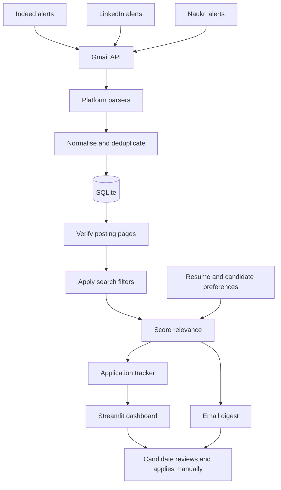

# Architecture

Job Agent is organised as a small pipeline. Each stage has a defined responsibility so that parsing, filtering and matching can be tested independently.

## Main modules

| Module | Responsibility |
| --- | --- |
| `gmail_client.py` | Gmail OAuth, reading alert messages and sending digests |
| `parsers/` | Extract job details and posting-time hints from supported alert formats |
| `normalize.py` | Normalise titles, companies and URLs; generate duplicate fingerprints |
| `db.py` | SQLite schema, job upserts and duplicate merging |
| `verify.py`, `dates.py` | Check posting pages, dates and expiry signals |
| `filters.py`, `locations.py` | Apply age, location, role, level and experience rules |
| `matcher.py` | Local relevance scoring and optional Gemini scoring |
| `resume.py` | Read local resume files and detect skills |
| `tracker.py` | Store application status, dates, notes and status history |
| `notify.py` | Build and send job digest emails |
| `pipeline.py` | Coordinate ingestion, processing, persistence and notifications |
| `dashboard.py` | Streamlit interface for jobs, settings and application tracking |

## Data model

The SQLite database keeps the main records separate:

- `jobs`: one record per normalised job, including source links and filtering/matching results.
- `applications`: the current application status, date, link and notes for a job.
- `status_history`: changes to application status.
- `processed_emails`: message identifiers used to avoid processing the same email repeatedly.
- `runs`: summary information for pipeline executions.

The database is intended for local use. It contains personal job-search information and should remain outside the public repository.

## Execution

The pipeline can be run locally from the command line or through the dashboard. The GitHub Actions workflow is manual-only and uses a temporary database; it is not a persistent hosted tracker.

## Privacy and safety

- Gmail access uses OAuth; the application does not ask for or store a Gmail password.
- OAuth files, environment files, local databases, logs and resume files are excluded from Git.
- Gemini scoring is optional. The local matcher remains available without an API key.
- The application does not submit job applications. The user reviews listings and applies manually.
- A hosted deployment requires a web-compatible Gmail OAuth flow and private persistent storage before personal records are used.
