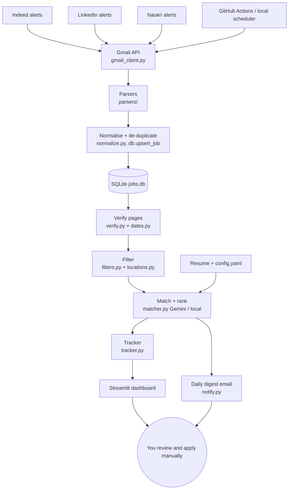

# Architecture

## Modules

| Module | Responsibility |
|---|---|
| `gmail_client.py` | OAuth, list/read messages, send digest |
| `parsers/` | Extract title, company, location, description, URL, "posted X ago" hint per platform |
| `normalize.py` | Canonical URLs, company/title normalisation, fingerprints |
| `db.py` | Schema, upsert with cross-platform duplicate merge (fingerprint + fuzzy title) |
| `verify.py`, `dates.py` | Open the page, read JSON-LD `datePosted`/`validThrough`, detect expired/404 |
| `filters.py`, `locations.py` | Strict 24 h window, location aliases, role/level/experience rules |
| `matcher.py` | Gemini JSON scoring with local fallback; reasons + gaps |
| `tracker.py` | Six statuses, application date/link/notes, history |
| `notify.py` | HTML digest, one-time notification per job |
| `pipeline.py` | Orchestrates one run; dependency-injected for tests |

## Data model

`jobs` (one row per unique posting, all source URLs kept) · `applications` (tracker) · `status_history` ·
`processed_emails` (idempotent ingestion) · `runs` (stats per run).

## Safety decisions

- Gmail scopes: read-only + send. No password stored; secrets only in `.env` / GitHub secrets.
- No code path submits an application. Human approval is built into the design.
